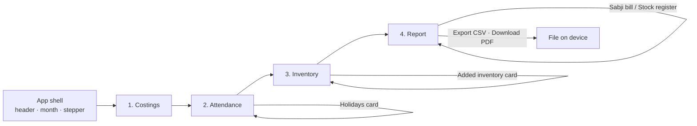

# ICDS Reports — UI Design Specification

A visual and interaction specification for the four-step ICDS Reports worksheet app.
It describes the global theme first, then every screen, so a designer or implementer
can build the interface without guessing.

| | |
|---|---|
| **Status** | Proposed — derived from the mockups in `docs/new_design/` |
| **Target** | Android first, phone portrait; tablet and desktop adapted |
| **Source of truth** | `costings.png`, `attendence.png`, `inventory.png`, `report.png` |
| **Out of scope** | Code structure, component APIs, file names, state management |
| **Colour caveat** | Hex values are sampled visually from the mockups and are **starting tokens**, not final brand values |

---

## 1. Purpose and scope

The app replaces a paper worksheet. A worker at an anganwadi centre enters four things —
rates, attendance, holidays and stock — and the app produces the two sheets the office
submits: the **sabji bill** and the **stock register**.

This document covers:

- the global theme: colour, type, spacing, shape, elevation, icons, layout grid, motion;
- the reusable component library;
- the four step screens, the shell around them, and the report;
- responsive behaviour, accessibility, and the empty / loading / error states.

It does **not** cover the arithmetic of the reports. The figures behind each column are
defined elsewhere; this document defines how those columns look and behave.

### 1.1 Screen map



---

## 2. Design principles

These are the rules every screen must satisfy. Where a mockup and a principle disagree,
the principle wins and the deviation is recorded in §11.

1. **One column, one scroll.** The phone is the primary surface. Content is a single
   vertical column; nothing is ever placed side by side that would force a sideways
   scroll, except report tables, which are explicitly swipeable.

2. **One step, one job.** Each screen asks for exactly one kind of input. Nothing on a
   later step is required to finish an earlier one.

3. **Calm surfaces, one loud colour.** The page is a pale blue-grey; content sits on white
   cards. Blue marks what is active and what moves the user forward. Nothing else competes.

4. **Colour carries meaning, never decoration.** Pink means mothers. Green means children.
   Crimson means closed. A user should be able to read a table by colour before reading
   a label — but never be forced to.

5. **Edit where you read.** Every editable number is a field in place, in the same table
   as the value it produces the report from. There are no separate "edit" screens and no
   modal forms for a single number.

6. **No Save button.** Every edit is persisted immediately. A phone put down mid-entry
   loses nothing. The only destructive action, reset, asks first.

7. **Blank is information.** A blank cell means "nothing to write": a closed day, or an
   item that is not served. A rate of `0` is therefore rendered as a blank in reports and
   as `0` only in the input that produces it.

8. **Input looks like input; output looks like output.** Fields have a border and a
   surface. Computed figures — totals, report cells — are plain text on a band. The user
   can tell, without tapping, which numbers they own.

9. **No "generate".** The report is always current. Moving to step 4 shows the month as it
   stands, recomputed from the inputs above.

10. **The footer always says where you are.** Back and Next are fixed to the bottom edge,
    outside the scrolling content, and are never hidden behind a scroll.

11. **Nothing is smaller than 12 sp of meaning.** Secondary text may be quiet, but a value
    the user must read or type never drops below 14 sp, and every tappable target is at
    least 48 × 48 dp.

---

## 3. Foundations

### 3.1 Colour

#### 3.1.1 Palette

All values are 6-digit hex. Names are semantic, so a future palette swap changes the table
at the top of this section and nothing else.

**Brand and primary**

| Token | Hex | Role |
|---|---|---|
| `Primary/700` | `#0F55B8` | Pressed state of a filled primary control |
| `Primary/600` | `#1667D9` | Filled buttons, active step node, active segment, links |
| `Primary/500` | `#2F7BEF` | The blue that connects step nodes; focus ring |
| `Primary/100` | `#DCE9FB` | Tinted buttons ("Add holiday", "Add item"), active segment fill, step halo |
| `Primary/050` | `#EEF5FE` | Empty-state wash, hover wash on tinted buttons |

**Surfaces and structure**

| Token | Hex | Role |
|---|---|---|
| `Canvas` | `#F1F5FB` | Page background, always visible between cards |
| `Surface` | `#FFFFFF` | Cards, table body, footer bar, dialogs |
| `Surface/Muted` | `#F8FAFD` | Secondary wash inside a card, e.g. a delivery row |
| `Table/Header` | `#E9EFF9` | Table header band and group-header neutral cells |
| `Border/Subtle` | `#E6EBF3` | Card outline, table cell border, divider |
| `Border/Strong` | `#CBD5E3` | Field border, segment-control outline, chip divider |
| `Scrim` | `#101828` at 40% | Behind dialogs |

**Text**

| Token | Hex | Role |
|---|---|---|
| `Text/Primary` | `#101828` | Titles, values, active labels |
| `Text/Secondary` | `#5A6B85` | Subtitles, column headers, helper copy |
| `Text/Tertiary` | `#8494AB` | Disabled values, placeholder, month in a chip |
| `Text/Inverse` | `#FFFFFF` | Text and icons on `Primary/600` |

**Semantic — head groups**

| Token | Hex | Role |
|---|---|---|
| `Mother/Band` | `#F7CBE1` | The `Mother` group header, deeper pink |
| `Mother/BG` | `#FBDCEC` | Mother group body tint, mother total cells |
| `Mother/Ink` | `#C2185B` | Mother group title, mother total values |
| `Children/Band` | `#CBEBD6` | The `Children` group header, deeper green |
| `Children/BG` | `#DDF2E4` | Children group body tint, children total cells |
| `Children/Ink` | `#12703F` | Children group title, children total values |

**Semantic — closed days**

| Token | Hex | Role |
|---|---|---|
| `Closed/Row` | `#FDEDEF` | A closed day's row background |
| `Closed/Field` | `#FBE3E7` | A closed day's disabled count field |
| `Closed/Ink` | `#C62828` | The weekday abbreviation and day number of a closed day |

**Semantic — status**

| Token | Hex | Role |
|---|---|---|
| `Danger` | `#D92D42` | Destructive confirmation, broken field, save failure |
| `Warning` | `#DE8F16` | Non-blocking notice, e.g. a delivery clamped into the month |
| `Success` | `#12703F` | Transient "Saved" confirmation |

#### 3.1.2 Icon tile sets

Pastel squares — actually circles — sit to the left of an item's name. They give a long
table a texture the eye can catch. Tiles are **decorative and never the only identifier**;
the label always sits beside them.

| Set | Background | Icon ink | Used for |
|---|---|---|---|
| Blue | `#E4F0FD` | `#1B6FD4` | Rice, morning snack, section headers for report/inventory-desk |
| Mint | `#DDF3E7` | `#17784B` | Vegetables, iodised salt, the Holidays card, Opening stock card |
| Pink | `#FCE4EE` | `#D6467F` | Masoor dal |
| Amber | `#FFF0D6` | `#DE8F16` | Egg, potato, mustard oil |

Section-level tiles are one step larger than row-level tiles (§4.5, §4.6.4).

#### 3.1.3 Rules of application

- **Never colour text with a group tint.** Group tints fill backgrounds; the readable ink
  is the `--Ink` token.
- **Only one filled blue element per view.** Usually the primary footer button or the
  active step node. A second filled blue steals the eye from the next action.
- **Closed is the only pink-red that is not "mother".** To avoid confusion, closed rows
  never use the mother group tick, and their pink is warmer and lighter.
- **A tinted field is not an error.** A pink-tinted attendance field means "closed, kept
  for later"; errors use `Danger` on a field border plus a message.

#### 3.1.4 Contrast

Approximate ratios against their intended background; verify with a checker before release.

| Pair | Approx. | Requirement |
|---|---|---|
| `Text/Primary` on `Surface` | 16.8:1 | AAA |
| `Text/Secondary` on `Surface` | 4.9:1 | AA normal text |
| `Text/Inverse` on `Primary/600` | 4.7:1 | AA normal text |
| `Mother/Ink` on `Mother/BG` | 5.8:1 | AA normal text |
| `Children/Ink` on `Children/BG` | 6.1:1 | AA normal text |
| `Closed/Ink` on `Closed/Row` | 5.2:1 | AA normal text |
| `Text/Tertiary` on `Surface` | 2.9:1 | Large or decorative only — never for a value the user must read |

### 3.2 Typography

**Family.** Inter, falling back to Roboto, then the platform sans. The mockups render a
grotesque with a tall x-height, matching this pair.

**Numerals.** Tables use tabular (monospaced) digits so column values align down the page.
Every number in a table, field or total is tabular. Prose is not.

| Role | Size | Weight | Line height | Tracking | Colour |
|---|---|---|---|---|---|
| Page title | 30 sp | 800 | 36 | −0.4 | `Text/Primary` |
| Page subtitle | 15 sp | 400 | 20 | 0 | `Text/Secondary` |
| Card title | 21 sp | 700 | 26 | −0.2 | `Text/Primary` |
| Card subtitle | 14 sp | 400 | 19 | 0 | `Text/Secondary` |
| Sub-section title (e.g. "March 2026") | 16 sp | 700 | 22 | 0 | `Text/Primary` |
| Table group header | 14 sp | 700 | 18 | 0 | Group ink |
| Table column header | 13 sp | 600 | 17 | 0 | `Text/Secondary` |
| Table cell | 16 sp | 500 | 22 | 0 | `Text/Primary` |
| Table cell, secondary column | 15 sp | 400 | 21 | 0 | `Text/Primary` |
| Total row label | 15 sp | 700 | 20 | 0 | `Text/Primary` |
| Total row value | 16 sp | 700 | 22 | 0 | Group ink |
| Field value | 16 sp | 500 | 22 | 0 | `Text/Primary` |
| Chip date | 22 sp | 700 | 24 | 0 | `Primary/600` |
| Chip month | 12 sp | 500 | 14 | 0.4 | `Text/Secondary` |
| Chip weekday | 15 sp | 500 | 20 | 0 | `Text/Secondary` |
| Button label | 17 sp | 600 | 22 | 0 | per variant |
| Step label | 13 sp | 500 / 700 active | 16 | 0 | `Text/Secondary` / `Text/Primary` |
| Step number | 14 sp | 700 | 18 | 0 | `Text/Inverse` / `Text/Secondary` |
| Hint / helper | 13 sp | 400 | 17 | 0 | `Text/Secondary` |
| Dialog title | 20 sp | 700 | 26 | 0 | `Text/Primary` |
| Dialog body | 15 sp | 400 | 21 | 0 | `Text/Secondary` |

**Rules.**

- Sentence case everywhere. No all-caps headings, no letter-spaced titles.
- `Title Case` is used only for the app name, "ICDS Reports".
- Units inside a label are parenthesised and lower-case: `Rice (g)`, `Mustard oil (ml)`.
- A period appears at the end of a card subtitle because it is a sentence; a table header
  never takes one.

### 3.3 Spacing

A 4 dp base scale. Only these steps are used.

| Token | Value | Typical use |
|---|---|---|
| `space/1` | 4 | Icon to label, chip internals |
| `space/2` | 8 | Cell padding inside a table cell, field padding |
| `space/3` | 12 | Row-to-row gap, header to subtitle |
| `space/4` | 16 | Card padding, page side padding, card gap |
| `space/5` | 20 | Section to section inside a card |
| `space/6` | 24 | Above the footer bar, dialog padding |
| `space/8` | 32 | Between the page title block and the first card |

### 3.4 Shape, border and elevation

| Token | Value | Applies to |
|---|---|---|
| `radius/card` | 20 dp | Cards, dialogs, empty-state panel |
| `radius/field` | 10 dp | Every input, table cell, chip |
| `radius/band` | 12 dp | Table header band, segmented control |
| `radius/pill` | 999 dp | Buttons, icon tiles, step nodes |
| `border/hairline` | 1 dp `Border/Subtle` | Card outline, table cell, divider |
| `border/field` | 1 dp `Border/Strong` | Inputs, chips, segmented outline |
| `border/dashed` | 1.5 dp dashed `Primary/500` at 40% | Empty-state panel |
| `shadow/card` | `0 1 2 rgba(16,24,40,0.05)` + `0 1 1 rgba(16,24,40,0.03)` | Card |
| `shadow/sheet` | `0 -4 16 rgba(16,24,40,0.06)` | Sticky footer |

Cards are distinguished from the canvas by **both** a hairline and a very soft shadow.
Neither alone is strong enough at phone brightness.

### 3.5 Icons

- Family: Material Symbols, **rounded**, weight 400, optical size 24. Section tiles use
  filled glyphs; row tiles use outlined glyphs at 20 dp; footer and button glyphs at
  20 dp.
- Icons are never the only label for an action. `Back` carries a chevron *and* a word.
- A row icon sits inside a 32 dp tile; a section icon sits inside a 44 dp tile.
- Decorative icons are hidden from assistive technology; meaningful icons carry the
  control's label instead.

### 3.6 Layout grid

```text
┌──────────────────────────────────────────┐  ← safe area
│ 16 dp side padding                       │
│ ┌──────────────────────────────────────┐ │
│ │ page title block                     │ │  32 dp below status/header
│ └──────────────────────────────────────┘ │
│ 16 dp                                    │
│ ┌──────────────────────────────────────┐ │
│ │ month selector (full-width variant)  │ │  48–56 dp tall
│ └──────────────────────────────────────┘ │
│ 16 dp                                    │
│ ┌──────────────────────────────────────┐ │
│ │ step indicator                       │ │  ~64 dp tall
│ └──────────────────────────────────────┘ │
│ 16 dp                                    │
│ ┌──────────────────────────────────────┐ │
│ │ card                                 │ │
│ │  16 dp padding                       │ │
│ └──────────────────────────────────────┘ │
│ 14 dp                                    │
│ ┌──────────────────────────────────────┐ │
│ │ card                                 │ │
│ └──────────────────────────────────────┘ │
│ ── scrolling content ends ──             │
│ ┌──────────────────────────────────────┐ │
│ │ sticky footer: Back        Next      │ │  76 dp + safe-area inset
│ └──────────────────────────────────────┘ │
└──────────────────────────────────────────┘
```

- **Page padding:** 16 dp left and right; 12 dp top from the safe area; 24 dp above the
  footer.
- **Card gap:** 14 dp.
- **Maximum content width:** 720 dp. Above that, content is centred and the canvas shows
  on both sides.
- **Minimum content width:** 320 dp. Fields shrink but never disappear.
- **Nothing has a fixed pixel width in a row.** Rows use proportional weights so the
  layout survives font scaling and narrow screens.

### 3.7 Motion

| Interaction | Duration | Curve |
|---|---|---|
| Step change (content swap) | 180 ms fade + 8 dp rise | ease-out |
| Card expand (a delivery appears) | 200 ms height | ease-in-out |
| Segment change | 150 ms tint cross-fade | linear |
| Dialog open / close | 200 ms fade + scale 0.96 → 1 | ease-out |
| Save confirmation | 120 ms fade in, hold 1.2 s, 200 ms fade out | ease-out |

Motion is short and functional. No spring, no bounce, no celebration animation: this is a
data-entry tool used repeatedly through a working day.

---

## 4. Components

### 4.1 App header

**Anatomy**

```text
ICDS Reports                    ⋮
Nutrition and service delivery reports
```

- The title is `Page title`; the subtitle is `Page subtitle` directly beneath, 4 dp gap.
- The overflow button is a 48 × 48 dp touch target at the top right, vertically aligned
  with the title line.
- The header is **not** a coloured bar. It sits directly on the canvas, with no card and
  no separator. This keeps the top of the screen light and lets the month selector be the
  first bounded object.

**States.** Static. The overflow button has a pressed wash of `Primary/050`.

**Do not** put navigation in the header; navigation lives in the footer.

### 4.2 Month selector

The month applies to all four steps, so it sits above them. Two variants share one job.

**Expanded variant — steps 1 to 3**

```text
┌──────────────────────────────────────────────────┐
│ [calendar]  March 2026                        ˅  │
└──────────────────────────────────────────────────┘
```

- Full width, `Surface` fill, 1 dp `Border/Strong`, `radius/field`, 52 dp tall, 16 dp
  horizontal padding.
- Leading calendar icon in `Text/Secondary` at 24 dp; label in `Field value`; trailing
  chevron in `Text/Secondary`.
- The whole control is the touch target, not just the chevron.

**Compact variant — step 4**

```text
                              ┌──────────────────────┐
ICDS Reports                  │ [cal] March 2026  ˅  │
Nutrition and service ...     └──────────────────────┘
```

- Sits at the right of the header block, on the title line.
- `Surface` fill, 1 dp `Border/Strong`, `radius/pill`, 40 dp tall, 120–180 dp wide.
- On the report the month is context, not an input, so it yields vertical space to the
  table. On a narrow screen (< 360 dp) it falls back to the expanded variant and moves
  below the title.

**Open state.** Tapping opens a scrolling sheet listing the last 12 months, newest first,
each row 48 dp tall, the current month marked with a check and `Primary/100` wash.
Selecting one closes the sheet and reloads the screen with that month's saved inputs.

**Rules.**

- The month label is always `Month YYYY` — never abbreviated, never numeric.
- A month with no saved edits opens with defaults; the user is not warned, because there
  is nothing to lose.

### 4.3 Step indicator

Four nodes on a connecting rail, above the cards. It tells the user how long the job is
and where they are.

```text
 ✓ ──────── ● ──────── ○ ──────── ○
Costings   Attendance  Inventory  Report
```

| Node state | Circle | Glyph | Label |
|---|---|---|---|
| **Passed** | `Primary/600` fill | white check, 18 dp | `Text/Secondary`, 13 sp, 500 |
| **Current** | `Primary/600` fill, plus an 8 dp `Primary/100` halo ring around it | white step number | `Text/Primary`, 13 sp, 700 |
| **Upcoming** | `Surface` fill, 1.5 dp `Border/Strong` | `Text/Secondary` step number | `Text/Secondary`, 13 sp, 500 |

- Node diameter 34 dp; the current node's halo brings the visual size to 50 dp.
- The rail between nodes is 2.5 dp. It is `Primary/500` up to and including the current
  node, and `Border/Strong` after it.
- Labels are centred under each node and always fit on one line at 320 dp.
- Labels are **numbered** on all four steps: `1. Costings`, `2. Attendance`,
  `3. Inventory`, `4. Report`. The mockups show both numbered and unnumbered variants;
  numbering is the chosen standard because it tells the user how much is left.
- Tapping a node jumps to that step. A tap on an upcoming step is allowed — nothing is
  gated — because every step can stand on its own.
- The strip scrolls with the page; it does not stick.

**Colour is not the only signal.** The check glyph and the bold label both mark progress,
so the indicator still reads in greyscale.

### 4.4 Card

The only container in the app. Every section of every step is a card.

- `Surface` fill, `radius/card`, 1 dp `Border/Subtle`, `shadow/card`, 16 dp padding.
- A card holds exactly one section: a header row (§4.5) and its content.
- Cards never nest. Where a delivery needs its own boundary, it uses a bordered row
  (§5.4.3), not a second card.
- A card is as tall as its content. It is never given a fixed height, so long tables grow
  and the page scrolls.

### 4.5 Section header

```text
┌────┐
│ 🪙 │  Costings
└────┘  Cost per head per day, in paisa. A rate of 0 means not served.
```

- A 44 dp circular icon tile in the section's pastel set.
- Title and subtitle stacked to the right, 4 dp apart.
- 12 dp gap between the tile and the text block; 16 dp below the block before content.
- The subtitle is always one sentence, always explains the rule or the unit, and never
  repeats the title.

**Section tiles in use**

| Screen | Section | Tile | Glyph |
|---|---|---|---|
| Costings | Costings | Blue | Coins |
| Costings | Per-head inventory | Mint | Open box |
| Attendance | Holidays | Mint | Calendar |
| Attendance | Daily attendance | Blue | Group of people |
| Inventory | Opening stock | Mint | Stacked layers / stock |
| Inventory | Added inventory | Blue | Delivery box |
| Report | Report — <Month Year> | Blue | Document with lines |

### 4.6 Data table

Both input tables and report tables use the same skeleton, so a user learns it once.

#### 4.6.1 Anatomy

```text
┌──────────────┬──────────────────┬──────────────────┐
│              │      Mother      │     Children     │  ← group header band
│     Item     ├────────┬─────────┼────────┬─────────┤
│              │Mon/Wed │Tue/Thu  │Mon/Wed │Tue/Thu  │  ← sub-header
├──────────────┼────────┼─────────┼────────┼─────────┤
│ 🥚 Egg       │  777   │   888   │  850   │    0    │  ← body row
├──────────────┼────────┼─────────┼────────┼─────────┤
│ Σ Total      │  861   │  1051   │  1017  │   634   │  ← total row
└──────────────┴────────┴─────────┴────────┴─────────┘
```

- **Header band:** `Table/Header` fill, `radius/band` on the top corners, 10 dp vertical
  padding. Group cells carry the group tint instead (`Mother/Band`, `Children/Band`).
- **Group cell:** centred group name in `Table group header` type with a small glyph —
  a single person for Mother, two people for Children. The glyph sits above or beside the
  word depending on width; above at phone widths.
- **Sub-header cell:** centred, `Table column header` type, on the group tint.
- **Body row:** `Surface`, separated by 1 dp `Border/Subtle` horizontal rules. No zebra
  striping — the tints and tiles already provide rhythm.
- **Numeric cell:** right-aligned, tabular numerals. Cells never show thousands separators
  in editable fields (`25640`, not `25,640`), so typing stays predictable. Report cells
  also stay unseparated, matching the paper.
- **First column** is left-aligned, holds the tile and the item name, and is the only
  column that may wrap to two lines (`Iodised salt (g)`).

#### 4.6.2 States

| State | Treatment |
|---|---|
| Default row | `Surface` |
| Closed day | `Closed/Row` fill; weekday and day number in `Closed/Ink`; fields disabled (§4.7) |
| Total row | Group tints across the value cells, `surface-muted` on the label cell; bold text; a Σ glyph beside the label |
| Read-only report row | no field borders; values are plain text |
| Selected / focused field | 1.5 dp `Primary/500` border plus a 2 dp `Primary/050` outer ring |
| Empty table | the table is replaced by the section's empty state (§4.11), never by an empty grid |

#### 4.6.3 Horizontal overflow

- Input tables always fit the phone width; they never scroll sideways.
- Report tables are wider than a phone. They scroll horizontally, with the **Date column
  frozen**.
- A frozen column gains a 1 dp `Border/Strong` right edge plus a soft 6 dp shadow only
  while the table is scrolled away from the start, so the user knows the column is pinned.
- A 4 dp rounded scroll indicator sits under the table, centred, with a 40 dp minimum
  thumb, in `Primary/500` at 45% opacity. It fades out 1 s after the last swipe.
- The swipe hint (§4.17) sits directly under the segmented control, above the table.

#### 4.6.4 Row icons

- 32 dp circular tile, 20 dp glyph, 10 dp right margin.
- The tile set is fixed per item and identical across Costings, Opening stock, Added
  inventory and the Report, so the same commodity always looks the same (§3.1.2).

#### 4.6.5 Sorting

**Decision:** the report tables carry **no sort affordances**. The rows are a calendar and
the final row is the month's closing total, so any reordering would separate totals from
their dates and contradict the paper. The mockup's small up/down chevrons in the header
are therefore omitted. If sorting is ever added, it must pin the Total row and reset on
month change; that is not part of this design.

### 4.7 Number field

The only input control in the app.

- `Surface` fill, 1 dp `Border/Strong`, `radius/field`, 8 dp horizontal padding, minimum
  44 dp tall (52 dp when the row has room).
- Value right-aligned, `Field value`, tabular numerals.
- Numeric keyboard only; non-digits are rejected as typed; negative values are impossible.
- A blank field is treated as `0` on commit, and the field then shows `0` only if the user
  leaves it — the reports still treat `0` as "not served" and print blank.
- **Disabled** (a closed day): `Closed/Field` fill, no border, `Text/Tertiary` value,
  not focusable, no caret. The value shown is the count the day will have when it reopens.
- Editing is committed on blur and on every valid keystroke; there is no confirm step.
- A field never shows a placeholder number; it either shows a value or is blank.

### 4.8 Holiday chip

```text
┌───────────────────────┐
│  Sun        ○        │
│  15                  │
│  Mar                 │
└───────────────────────┘
```

- `Mother/BG` fill — the closed-day pink family — `radius/field`, 1 dp `Border/Subtle`,
  12 dp padding.
- A single stacked block: the weekday in `Chip weekday` (`Text/Secondary`), the day
  number in `Chip date` (`Primary/600`), the month in `Chip month` (`Text/Tertiary`).
  Reading down, it says *which day, which date, which month* — the order the week is
  spoken in, and it keeps the biggest figure on the same line whether or not a weekday
  name is long.
- A 28 dp round remove button at the right, `Border/Subtle` circle with an × glyph.
  Its touch target is 44 dp even though the visual is smaller.
- Chips flow left to right and wrap; 10 dp gap.
- Tapping × reopens the day immediately — no confirmation — because the day's counts are
  restored and the action is undone by re-closing it.

### 4.9 Buttons

| Variant | Fill | Border | Label | Use |
|---|---|---|---|---|
| **Filled** | `Primary/600` | none | `Text/Inverse` | The forward action: `Next`, `Download PDF`, `Reset` |
| **Outlined** | transparent | 1.5 dp `Primary/600` | `Primary/600` | The alternative action: `Back`, `Export CSV` |
| **Tinted** | `Primary/100` | none | `Primary/600` | Additive actions inside a card: `Add holiday`, `Add item` |
| **Text** | transparent | none | `Primary/600` | Low-priority options in dialogs: `Cancel` |
| **Destructive** | `Danger` | none | `Text/Inverse` | Confirming reset |

- Height 52 dp; `radius/pill`; 20 dp horizontal padding; icon then label, 8 dp apart.
- Full-width variants stretch to the card's inner width (`Add holiday`, `Add item`).
- **Disabled:** 38% opacity of the whole control, no shadow, no press state.
- **Pressed:** fill drops one step (`Primary/700`) or, for outlined and tinted, gains a
  `Primary/050` wash.

### 4.10 Segmented control

Switches the two reports. It is a selector, not a tab bar: always two, always outlined.

- Container: `Surface`, 1.5 dp `Border/Strong`, `radius/band`, 4 dp inner padding, 44 dp
  tall.
- Segment: equal widths, 16 dp radius, 36 dp tall.
- **Selected:** `Primary/100` fill, `Primary/600` label at 700, and a check glyph before
  the label.
- **Unselected:** transparent, `Text/Secondary` label at 500.
- The control is as wide as its content up to the card width; the two segments are equal.
- Switching redraws the table only — the card, title, subtitle and hint stay still, so the
  context does not jump.

### 4.11 Empty state

```text
┌ ─ ─ ─ ─ ─ ─ ─ ─ ─ ─ ─ ─ ─ ─ ─ ─ ─ ┐
│              [box]                 │
│      No deliveries added yet       │
│  Tap the button below to add one.  │
└ ─ ─ ─ ─ ─ ─ ─ ─ ─ ─ ─ ─ ─ ─ ─ ─ ─ ┘
```

- A dashed `1.5 dp` panel in `Primary/500` at 40%, `radius/card`, `Primary/050` wash,
  24 dp padding.
- A 40 dp outline glyph of the thing that is missing, in `Primary/600` at 70%, with three
  short accent strokes above it to suggest "something can arrive here".
- Title: 16 sp, 700, `Text/Primary`. Body: 14 sp, 400, `Text/Secondary`, centred, max
  two lines.
- The panel is followed by the card's additive button (`Add item`).
- Empty states replace a table or list wholesale. They never appear above or beside data.

### 4.12 Sticky footer

- Fixed to the bottom edge, above the system navigation inset.
- `Surface` fill, 1 dp top `Border/Subtle`, `shadow/sheet`, 16 dp side padding, 12 dp
  vertical padding, minimum 76 dp content height.
- **Steps 1–3:** `Back` (outlined) on the left, `Next` (filled) on the right, each 132 dp
  minimum, 12 dp gap. `Back` is disabled on step 1; `Next` is disabled on step 4 — but
  step 4 uses the report footer instead.
- **Step 4:** `Export CSV` (outlined, download glyph) on the left, `Download PDF` (filled,
  PDF glyph) on the right, splitting the width evenly.
- The footer never scrolls and never overlaps content: the page leaves 96 dp of bottom
  padding so the last card clears it.
- A disabled `Back` on step 1 is still rendered, not hidden, so the footer does not change
  width between screens.

### 4.13 Overflow menu

- Trigger: vertical three-dot glyph, 48 dp target, top right of the header.
- Menu: a small sheet anchored to the trigger, `Surface`, `radius/band`, `shadow/sheet`,
  8 dp padding, rows 48 dp tall.
- One item: `Reset data`, with a restart glyph in `Text/Primary`.
- Selecting it opens the reset dialog (§4.14.2). The menu closes first.

### 4.14 Dialogs

All dialogs are modal, use `Surface` with `radius/card`, 24 dp padding, a 40% `Scrim`
behind them, and dismiss on backdrop tap only when nothing would be lost.

#### 4.14.1 Date picker

Used by `Add holiday` and by a delivery's date button.

- Standard calendar month view, constrained to the open month's first and last day. Days
  outside the month are disabled.
- Title states the job: `Add a holiday` or `Date added`.
- Confirm and cancel in the dialog footer; confirm is disabled until a day is picked.
- A day already closed is shown with the closed tint and cannot be picked again.
- On confirm the dialog closes before the screen redraws, so the new chip or date appears
  without the scrim flickering.

#### 4.14.2 Reset confirmation

```text
Reset all data?

Every edit goes back to the shipped defaults, and the
saved copy is deleted.

                     Cancel    Reset
```

- Title 20 sp 700; body `Dialog body`; actions right-aligned.
- `Cancel` is a text button; `Reset` is destructive (`Danger` fill).
- `Reset` does not autofocus; the destructive action is never one stray tap away.
- After reset, the app returns to step 1 of the current month.

#### 4.14.3 Delivery editor

Not a dialog. Deliveries are edited inline on the card (§5.4.3) because they are a list,
not a single value.

### 4.15 Inline banner

For a problem the user can fix, or a save that failed.

- Full card width, `radius/field`, 12 dp padding, 10 dp icon + text gap.
- Error: `#FDECEE` fill, `Danger` border at 30%, `Danger` glyph, title 15 sp 700, body
  14 sp 400.
- Warning: `#FFF6E5` fill, `Warning` border at 30%, `Warning` glyph.
- Appears directly under the section header of the card it belongs to, never as a toast
  alone, because it must be read.

### 4.16 Loading and skeleton

- First paint shows the app header, month selector and stepper immediately; the cards show
  skeleton blocks: `Border/Subtle` rounded bars at 40% opacity for titles, and 48 dp tall
  rows for table lines.
- Skeletons shimmer over 1.2 s, left to right, at 6% opacity delta. No spinner.
- The footer is present but disabled while loading.
- Loading is expected only on a cold start; a month switch reuses the skeleton for the
  card area only.

### 4.17 Swipe hint

```text
↔  Swipe table to view all columns  →
```

- One line, `Hint` type, `Text/Secondary`, centred, 8 dp above the table.
- The two arrow glyphs are `Primary/600`.
- Shown only where a table overflows, and only until the table has been swiped once in
  that session; after that, hidden to save the space.

### 4.18 Autosave status

The app has no save button, so it reports quietly instead.

- Default: nothing is shown.
- While writing: `Saving…` in `Text/Tertiary`, 12 sp, at the start of the footer bar.
- On success: `Saved`, `Success` ink, fades out after 1.2 s.
- On failure: `Couldn't save these changes` in `Danger` with a `Retry` text button, and it
  stays until the write succeeds. This is the only persistent footer message.

---

## 5. Page specifications

The four steps share the shell. The shell is described once, then each screen adds its
cards.

### 5.1 Global shell

```text
┌──────────────────────────────────────────┐
│ ICDS Reports                          ⋮  │
│ Nutrition and service delivery reports   │
│                                          │
│ ┌──────────────────────────────────────┐ │
│ │  March 2026                       ˅  │ │   expanded variant on steps 1–3
│ └──────────────────────────────────────┘ │
│                                          │
│   ✓ ─── ● ─── ○ ─── ○                   │
│ Costings Attendance Inventory Report     │
│                                          │
│ ┌──────────────────────────────────────┐ │
│ │  card                                │ │
│ └──────────────────────────────────────┘ │
│ ┌──────────────────────────────────────┐ │
│ │  card                                │ │
│ └──────────────────────────────────────┘ │
│                                          │
├──────────────────────────────────────────┤
│  ( Back )                    ( Next → )  │
└──────────────────────────────────────────┘
```

**Copy**

| Element | Text |
|---|---|
| Title | `ICDS Reports` |
| Subtitle | `Nutrition and service delivery reports` |
| Overflow tooltip | `Menu` |
| Menu item | `Reset data` |

**Behaviour**

- Changing month keeps the current step and redraws every card with that month's data.
- Back and Next move one step. They do not validate; every step is optional to complete.
- Nothing is ever blocked. A month can be reported with zero attendance entered.

---

### 5.2 Step 1 — Costings

**Purpose.** Set what one head costs per day and how much of each commodity one head is
given. These rates are shared by every month.

#### 5.2.1 Layout

```text
┌ Card: Costings ──────────────────────────┐
│ [🪙]  Costings                            │
│       Cost per head per day, in paisa.    │
│       A rate of 0 means not served.       │
│                                           │
│ ┌──────────┬───────────┬────────────────┐ │
│ │          │  Mother   │   Children     │ │
│ │   Item   ├─────┬─────┼───────┬────────┤ │
│ │          │MWF  │ TTS │ MWF   │  TTS   │ │
│ ├──────────┼─────┼─────┼───────┼────────┤ │
│ │ 🥚 Egg   │ 777 │ 888 │  850  │   0    │ │
│ │ 🥬 Veg   │  0  │ 23  │   0   │   41   │ │
│ │ 🥔 Potato│ 84  │ 140 │   0   │  168   │ │
│ │ 🥣 Morn. │  0  │  0  │  167  │  425   │ │
│ │    snack │     │     │       │        │ │
│ ├──────────┼─────┼─────┼───────┼────────┤ │
│ │ Σ Total  │ 861 │1051 │ 1017  │  634   │ │
│ │ per head │     │     │       │        │ │
│ └──────────┴─────┴─────┴───────┴────────┘ │
└───────────────────────────────────────────┘
┌ Card: Per-head inventory ────────────────┐
│ [📦]  Per-head inventory                  │
│       Quantity per head per serving day,  │
│       in the item's own unit.             │
│                                           │
│ ┌──────────┬───────────┬────────────────┐ │
│ │          │  Mother   │   Children     │ │
│ │   Item   ├─────┬─────┼───────┬────────┤ │
│ │          │MWF  │ TTS │ MWF   │  TTS   │ │
│ ├──────────┼─────┼─────┼───────┼────────┤ │
│ │ 🍚 Rice  │ 110 │  75 │   50  │   75   │ │
│ │ 🫘 Masoor│  0  │  30 │   0   │   30   │ │
│ │ 🫗 Oil   │  2  │   2 │   2   │    2   │ │
│ │ 🧂 Salt  │  2  │   2 │   2   │    2   │ │
│ └──────────┴─────┴─────┴───────┴────────┘ │
└───────────────────────────────────────────┘
```

#### 5.2.2 Copy

| Element | Text |
|---|---|
| Card title | `Costings` |
| Card subtitle | `Cost per head per day, in paisa. A rate of 0 means not served.` |
| Column group | `Mother` / `Children` |
| Column sub-headers | `Mon/Wed/Fri` / `Tue/Thu/Sat` |
| Item column | `Item` |
| Items | `Egg`, `Vegetables`, `Potato`, `Morning snack` |
| Total row | `Total per head` |
| Second card title | `Per-head inventory` |
| Second card subtitle | `Quantity per head per serving day, in the item's own unit.` |
| Items, second table | `Rice (g)`, `Masoor dal (g)`, `Mustard oil (ml)`, `Iodised salt (g)` |

#### 5.2.3 Rows

| # | Item | Tile | Unit shown in label | Notes |
|---|---|---|---|---|
| 1 | Egg | Amber, egg glyph | none | |
| 2 | Vegetables | Mint, leafy green glyph | none | |
| 3 | Potato | Amber, potato glyph | none | |
| 4 | Morning snack | Blue, bowl glyph | none | **One item, two rates.** The `Mon/Wed/Fri` column is breakfast-and-snack served on those days; the `Tue/Thu/Sat` column is the same service on the other days. There is no separate `Breakfast` or `Snack` row. |

#### 5.2.4 Rules

- Every rate is a whole number of paisa, minimum 0, maximum 5 digits.
- `0` means **not served** for that head on that day type. The input shows `0`; the report
  prints a blank.
- The **Total per head** row is computed, never edited: each column is the sum of that
  column's four items.
- The total row is visually distinct: Σ glyph, bold label, group tints across its four
  values, and a `Surface/Muted` label cell.
- The per-head inventory table has no total row; quantities are not additive across items.
- Both tables are always fully visible; no pagination, no collapsing.
- Edits save immediately. Changing a rate here changes the report for **every** month,
  which the help text states implicitly by not mentioning months at all.

#### 5.2.5 States

| State | Presentation |
|---|---|
| Normal | as above |
| Editing a field | focus ring; the computed total updates on each valid keystroke |
| A field emptied | treated as `0`; the total updates |
| A field with non-digit input | rejected as typed; nothing is inserted |
| Any rate changed | the report for the open month is stale until step 4 is opened; no badge is shown |

---

### 5.3 Step 2 — Attendance

**Purpose.** Say which days the centre was open and how many people came.

#### 5.3.1 Layout

```text
┌ Card: Holidays ──────────────────────────┐
│ [📅]  Holidays                            │
│       Closed days are excluded from       │
│       attendance and consumption.         │
│                                           │
│ March 2026                                │
│ ┌──────────┐ ┌──────────┐ ┌──────────┐   │
│ │15│ Sun × │ │22│ Sun × │ │29│ Sun × │   │
│ │Mar       │ │Mar       │ │Mar       │   │
│ └──────────┘ └──────────┘ └──────────┘   │
│ ┌───────────────────────────────────────┐ │
│ │          +  Add holiday               │ │
│ └───────────────────────────────────────┘ │
└───────────────────────────────────────────┘
┌ Card: Daily attendance ──────────────────┐
│ [👥]  Daily attendance                    │
│       People present each day.            │
│       Sundays start closed.               │
│                                           │
│ ┌─ Date ────────┬─ Mother ─┬─ Children ─┐ │
│ │ Sun 01        │    4     │     28     │ │  closed row
│ │ Mon 02        │    4     │     28     │ │
│ │ Tue 03        │    4     │     28     │ │
│ │ Wed 04        │    4     │     28     │ │
│ └───────────────┴──────────┴────────────┘ │
└───────────────────────────────────────────┘
```

#### 5.3.2 Copy

| Element | Text |
|---|---|
| Card title | `Holidays` |
| Card subtitle | `Closed days are excluded from attendance and consumption.` |
| Sub-section title | the month, e.g. `March 2026` |
| Add button | `Add holiday` |
| Remove tooltip | `Reopen this day` |
| Second card title | `Daily attendance` |
| Second card subtitle | `People present each day. Sundays start closed.` |
| Columns | `Date` · `Mother` · `Children` |

#### 5.3.3 Holidays card

- The sub-section title repeats the month. It is not redundant: the chip month is
  abbreviated while the picker above uses the full name, and this line is the unambiguous
  reference.
- Chips are listed in date order, wrapping. There is no maximum and no horizontal scroll.
- `Add holiday` is a full-width tinted button with a `+` glyph.
- Adding opens the date picker (§4.14.1), constrained to the open month. Confirming closes
  the day, blanks its report row, and leaves its stored counts intact.
- Removing a chip reopens the day and restores the counts it had before it closed.
- A month with no holidays shows the empty state in place of the chips:
  `No closed days this month` / `Every day is a working day.` The `Add holiday` button
  remains below it.
- Sundays are pre-populated as chips. The default month is therefore never "empty".

#### 5.3.4 Daily attendance table

- One row per calendar day of the month, ascending. The order is fixed; it is a calendar,
  so there is no sorting.
- Columns: `Date`, `Mother`, `Children`. Both count columns are right-aligned fields.
- **Working day:** white row, two editable fields holding whole numbers (defaults 4 and
  28 for a fresh month).
- **Closed day:** `Closed/Row` background; the weekday abbreviation and day number in
  `Closed/Ink`; the two count fields rendered disabled (`Closed/Field`), showing the
  counts the day retains. The fields cannot be focused. This deliberately shows the
  retained numbers rather than blanks: a blank would imply the counts were lost, and a
  reopened day would then surprise the user.
- The weekday is always a three-letter abbreviation (`Sun`, `Mon`), followed by a
  two-digit day (`01`). A fixed-width weekday column keeps the numbers aligned.
- Counts are whole numbers, minimum 0. There is no maximum, but a count above 999 is
  highlighted with a `Warning` border and the helper line `Check this count`.
- Rows are 52 dp tall minimum, giving each field a comfortable target.
- The whole table is editable in place. There is no per-row save and no editing dialog.
- Sunday rows are **not** locked from being reopened: removing the Sunday chip turns the
  row white and editable again.

#### 5.3.5 States

| State | Presentation |
|---|---|
| Normal | Sunday rows closed, working rows editable |
| Adding a holiday | date picker over the card; scrim behind it |
| No holidays | empty state + `Add holiday` |
| Last holiday removed | card switches to the empty state without a redraw of the month above |
| Invalid count (letters) | rejected as typed |
| Count above 999 | warning border + helper line; edit still commits |

---

### 5.4 Step 3 — Inventory

**Purpose.** Say where each commodity's ledger starts, and record what was delivered during
the month.

#### 5.4.1 Layout

```text
┌ Card: Opening stock ─────────────────────┐
│ [🪙]  Opening stock                       │
│       The stock each commodity's ledger   │
│       starts from.                        │
│                                           │
│ ┌─ Commodity ───────────────┬── Opening ─┐│
│ │ 🍚 Rice (g)               │   25640    ││
│ │ 🫘 Masoor dal (g)         │   20400    ││
│ │ 🫗 Mustard oil (ml)       │    3272    ││
│ │ 🧂 Iodised salt (g)       │    3272    ││
│ └───────────────────────────┴────────────┘│
└───────────────────────────────────────────┘
┌ Card: Added inventory ───────────────────┐
│ [📦]  Added inventory                     │
│       A delivery counts from its own day  │
│       on, and is clamped into the month.  │
│                                           │
│  ╭ ─ ─ ─ ─ ─ ─ ─ ─ ─ ─ ─ ─ ─ ─ ─ ─ ─ ╮  │
│  │             [📦]                   │  │
│  │     No deliveries added yet       │  │
│  │  Tap the button below to add a    │  │
│  │             delivery.             │  │
│  ╰ ─ ─ ─ ─ ─ ─ ─ ─ ─ ─ ─ ─ ─ ─ ─ ─ ─ ╯  │
│ ┌───────────────────────────────────────┐ │
│ │            +  Add item                │ │
│ └───────────────────────────────────────┘ │
└───────────────────────────────────────────┘
```

#### 5.4.2 Copy

| Element | Text |
|---|---|
| Card title | `Opening stock` |
| Card subtitle | `The stock each commodity's ledger starts from.` |
| Columns | `Commodity` · `Opening` |
| Second card title | `Added inventory` |
| Second card subtitle | `A delivery counts from its own day on, and is clamped into the month.` |
| Empty title | `No deliveries added yet` |
| Empty body | `Tap the button below to add a delivery.` |
| Add button | `Add item` |

#### 5.4.3 Opening stock table

- One row per commodity, in this fixed order: Rice, Masoor dal, Mustard oil, Iodised salt.
- The label carries the unit in parentheses; the field carries the bare number.
- Fields are `Number field` (§4.7) and accept whole numbers only; minimum 0.
- There is no total row: stocks are in different units and are not additive.
- The commodity tile sets match Costings' per-head inventory table, so `Rice` looks the
  same on every screen.

#### 5.4.4 Added inventory card

**Empty state (no deliveries).** The dashed panel from §4.11 with a delivery-box glyph,
then the full-width `Add item` button.

**Filled state.** One bordered row per delivery, stacked, 10 dp apart. Each row is a
`Surface/Muted` panel with `radius/field` and a 1 dp `Border/Subtle`, holding two lines:

```text
┌────────────────────────────────────────────┐
│ 🍚  Rice (g)                          🗑    │   line 1: item + delete
│ ┌────────────────────┐ ┌─────────────────┐ │
│ │ [cal] 17 Mar 2026  │ │    30000     g  │ │   line 2: date + amount + unit
│ └────────────────────┘ └─────────────────┘ │
└────────────────────────────────────────────┘
```

- Line 1: a 32 dp commodity tile, the item name in a select control, and a 44 dp delete
  button.
- Line 2: an outlined date button showing `DD Mon YYYY` with a calendar glyph, then the
  amount field, then the unit as plain `Hint` text.
- The item select lists the four commodities with their units.
- The date opens the date picker constrained to the month. A date outside the month cannot
  be chosen, which is what "clamped into the month" means in practice.
- The amount accepts whole numbers, minimum 0. Changing the item does not change the amount.
- Deleting a row removes it immediately, with no confirmation; the row is easy to re-add.
- A list of deliveries keeps the `Add item` button below the last row.
- An item can be delivered more than once; rows are independent and are not merged.

#### 5.4.5 States

| State | Presentation |
|---|---|
| No deliveries | dashed empty state + `Add item` |
| One or more deliveries | rows + `Add item` |
| New row just added | appears at the end with the first commodity and day 1, amount `0`; visually emphasised with a brief `Primary/050` flash |
| Deleting the last row | card returns to the empty state |
| Amount 0 | allowed; the delivery is simply nothing |

---

### 5.5 Step 4 — Report

**Purpose.** Show the finished month as the two office sheets, and let the user take them
away.

#### 5.5.1 Layout

```text
 ICDS Reports                 ┌──────────────────┐
 Nutrition and service ...    │ [cal] March 2026˅│   compact month
                              └──────────────────┘

  ✓ ──── ✓ ──── ✓ ──── ●
1. Costings 2. Attendance 3. Inventory 4. Report

┌ Card: Report — March 2026 ───────────────┐
│ [📄]  Report — March 2026                 │
│       Blank cells indicate a closed day   │
│       or an item not served.              │
│                                           │
│ ( ✓ Sabji bill | Stock register )         │
│ ↔ Swipe table to view all columns →       │
│ ┌─ Date ─┬─ Total beneficiaries ─┬ ... ┐  │
│ │ Sun 01 │          32            │      │  closed row
│ │ Mon 02 │          32            │   4  │
│ │ Tue 03 │          32            │      │
│ │ Wed 04 │          32            │   4  │
│ │ ...    │                        │      │
│ └────────┴────────────────────────┴──────┘
│            ▬▬▬▬                          │   scroll indicator
└───────────────────────────────────────────┘

├──────────────────────────────────────────┤
│ ( ⬇ Export CSV )   ( 📄 Download PDF )   │
└──────────────────────────────────────────┘
```

#### 5.5.2 Copy

| Element | Text |
|---|---|
| Card title | `Report — March 2026` (the month is part of the title) |
| Card subtitle | `Blank cells indicate a closed day or an item not served.` |
| Segments | `Sabji bill` · `Stock register` |
| Swipe hint | `Swipe table to view all columns` |
| Footer | `Export CSV` · `Download PDF` |
| Total row label | `Total` |

#### 5.5.3 Layout rules

- The month selector uses the compact variant (§4.2), freeing vertical space.
- The report keeps the same step indicator as the other steps, with all four nodes passed
  and the fourth current.
- The card holds the segmented control, the swipe hint and the table, in that order.
- Table cells are read-only: no borders, no fields. Values are plain text on the row band.
- The **Date column is frozen**; the remaining columns scroll horizontally.
- The **Total row is the last row**, bold, with tinted value cells and `Total` in the Date
  column. It is never sorted and never separated from the dates.
- Report numbers use two decimal places for money (`42.50`) and no decimals for counts and
  quantities. A blank cell is empty — it is never `0`, `-`, or `N/A`.

#### 5.5.4 Sabji bill columns

Grouped headers follow the mockup: a tint band names the group, the sub-header names the
day type.

| Group | Column | Display label | Format |
|---|---|---|---|
| — | 1 | `Date` | `Sun 01` (frozen) |
| — | 2 | `Total beneficiaries` | integer |
| Pregnant + lactating | 3 | `Mon/Wed/Fri` | integer or blank |
| Pregnant + lactating | 4 | `Tue/Thu/Sat` | integer or blank |
| Children | 5 | `Mon/Wed/Fri` | integer or blank |
| Children | 6 | `Tue/Thu/Sat` | integer or blank |
| Other children | 7 | `Mon/Wed/Fri` | always blank |
| Other children | 8 | `Tue/Thu/Sat` | always blank |
| — | 9 | `Total egg cost` | money |
| Vegetables | 10 | `Mother` | money |
| Vegetables | 11 | `Child` | money |
| Potato | 12 | `Mother` | money |
| Potato | 13 | `Child` | money |
| — | 14 | `Total veg + potato` | money |
| Morning snack | 15 | `Mon/Wed/Fri` | money |
| Morning snack | 16 | `Tue/Thu/Sat` | money |
| — | 17 | `Daily total cost` | money |

- `Other children` is a reserved group: the sheet has the columns, the app writes blanks.
  Its header is muted (`Text/Tertiary`) to show it is not in use, and it is never hidden —
  the printed sheet must match the office's column order.
- `Pregnant + lactating` uses the `Mother` tint; `Children` uses the `Children` tint. The
  money groups are neutral.
- The two morning snack columns are the same item split by day type: only the matching
  column is written on a given day.

#### 5.5.5 Stock register columns

| Group | Column | Display label | Format |
|---|---|---|---|
| — | 1 | `Date` | `Sun 01` (frozen) |
| Attendance | 2 | `MS (morning snack) beneficiaries` | integer |
| Attendance | 3 | `HCM children 6m–6y` | integer |
| Attendance | 4 | `HCM pregnant + lactating` | integer |
| Attendance | 5 | `THR (SAM + SUW)` | integer |
| Rice | 6 | `Balance (Kg)` | integer or blank |
| Rice | 7 | `Consumption (Kg)` | integer or blank |
| Masoor dal | 8 | `Balance (Kg)` | integer or blank |
| Masoor dal | 9 | `Consumption (Kg)` | integer or blank |
| Mustard oil | 10 | `Balance (Ltr)` | integer or blank |
| Mustard oil | 11 | `Consumption (Ltr)` | integer or blank |
| Iodised salt | 12 | `Balance` | integer or blank |
| Iodised salt | 13 | `Consumption` | integer or blank |
| Commodity 5 | 14 | `Balance` | always blank |
| Commodity 5 | 15 | `Consumption` | always blank |
| Money | 16 | `Morning snacks & THR value (Item 1)` | money |
| Money | 17 | `Morning snacks & THR value (Item 2 – egg)` | money |
| Money | 18 | `Vegetable value` | money |
| Money | 19 | `Potato value` | money |

- Group tints: `Rice`, `Masoor dal`, `Mustard oil` and `Iodised salt` reuse their commodity
  tile colours as very light header washes. `Commodity 5` is muted, like `Other children`.
- A `Balance` column's total is the **stock left at month end**, not a sum. To stop that
  being misread, the Total row's balance cells carry the suffix `closing` in `Hint` type
  under the value.
- Balance columns alternate a `Surface/Muted` wash with `Surface` between commodities, so a
  row reads across four commodities without losing its place.

#### 5.5.6 Total row

- Label `Total` in the Date column, 15 sp 700.
- Every value cell bold and tinted with its group's wash; money cells show two decimals.
- Balance cells show the closing balance, annotated `closing`.
- A column that is blank for the whole month stays blank in the total; it never becomes `0`.

#### 5.5.7 Export

- `Export CSV` writes the currently visible sheet only, with the same headers the table
  shows (group names flattened into the column label, e.g.
  `Pregnant + lactating Mon/Wed/Fri`).
- `Download PDF` writes the same sheet as a landscape A4 page with the app title, the month,
  and the sheet name in the header.
- Both actions show a transient progress state on the button itself (`Exporting…`), and a
  `Success` confirmation on completion. A failure shows the inline banner (§4.15) inside
  the card.
- If the OS asks where to save, the default filename is
  `icds-sabji-bill-march-2026.csv` / `.pdf` (or `icds-stock-register-…`).

#### 5.5.8 States

| State | Presentation |
|---|---|
| Normal | table, hint, indicator, report footer |
| Month with no attendance | rows all blank except `Date`; total row blank; no warning |
| Sheet switched | table cross-fades; scroll position resets to the start |
| Table scrolled | Date column pinned with shadow; indicator visible |
| Exporting | button shows progress, other export disabled |
| Export failed | inline error banner in the card |

---

## 6. Cross-cutting behaviour

### 6.1 Editing model

| Action | Result |
|---|---|
| Typing a valid digit | value commits immediately; the screen does not redraw |
| Emptying a field | treated as `0` |
| Typing a letter or symbol | rejected; nothing appears |
| Leaving a field | if blank, it settles to `0` |
| Changing a rate | affects every month's report |
| Adding a delivery | affects the open month's register only |

Nothing in the app requires a save action. A change that alters the **shape** of the screen
(a holiday, a delivery, a month, a step) redraws it; a change that only alters a **value**
does not, so the keyboard is never dismissed by a redraw.

### 6.2 Closed days

A day is closed when it is a Sunday by default or was added as a holiday.

| Surface | Closed-day treatment |
|---|---|
| Attendance row | pink row, crimson weekday and day number, disabled tinted fields holding the retained counts |
| Holidays card | the chip exists and the day appears in the month's chip list |
| Report row | all cells except `Date` are blank |
| Stock register | no consumption, no balance movement |
| Totals | the day contributes nothing |

Reopening a day restores the counts it had before it closed. The app never resets a closed
day to the default counts.

### 6.3 Blank versus zero

This is the most important rule to render correctly.

| Where | `0` shows as | Why |
|---|---|---|
| Any input field | `0` | The user typed it; it must be visible and editable |
| Rate table total row | a real sum, possibly `0` | It is arithmetic, not a serving decision |
| Report count column | empty | Not served / closed |
| Report money column | empty | Not served / closed |
| Report balance column | empty | Not served / closed |
| Report total row | empty when the whole column is empty | Nothing to total |

A report cell that would be `0` is **empty**, and the card subtitle says so.

### 6.4 Month switching

- The month is global. Switching redraws every card with that month's inputs.
- Attendance is carried across by day of month: opening a new month starts from the last
  saved month's counts for the same day number, or the defaults (4 / 28) where that day
  does not exist.
- Holidays are per month; a new month starts with its Sundays closed.
- Deliveries are per month; a new month starts with none.
- Rates are shared and never carry.

The user is not shown a confirmation when switching, because nothing is discarded.

### 6.5 Navigation

- Back and Next move one step and preserve all edits.
- Tapping a step node jumps directly.
- Switching month keeps the current step.
- Leaving and reopening the app returns to the last saved month, on step 1.
- The Android system back gesture moves one step back before leaving the app.

### 6.6 Scrolling and safe areas

- The page scrolls vertically, under a fixed footer.
- The footer respects the bottom system inset; the content respects the top inset.
- The keyboard must not cover the field being edited: on focus, the page scrolls the field
  to sit at least 24 dp above the keyboard.
- Horizontal scrolling is reserved for report tables. Any other horizontal scroll is a bug.

---

## 7. Responsive behaviour

| | Phone portrait (primary) | Phone landscape / small tablet | Tablet and desktop |
|---|---|---|---|
| Page padding | 16 dp | 24 dp | 24 dp |
| Content width | full | full | max 720 dp, centred |
| Cards | stacked | stacked | stacked |
| Rate table | 1 label + 4 fields in the row | same | same, wider fields |
| Report table | horizontal scroll, Date frozen | horizontal scroll | all columns visible; no hint or indicator |
| Footer | fixed bar | fixed bar | fixed bar, max 720 dp wide, centred |
| Month selector | expanded; compact on step 4 | expanded; compact on step 4 | expanded; compact on step 4 |
| Step labels | `1. Costings` on one line | one line | one line |
| Dialogs | full-width sheet with 16 dp margins | 480 dp card | 480 dp card |

Breakpoints: **< 600 dp** phone, **600–1024 dp** tablet, **> 1024 dp** desktop. At tablet
width the four rate fields gain room but the layout never becomes two columns: a single
scroll is a principle, not a phone limitation.

`320 dp` is the narrow floor and `1.3×` font scaling the maximum tested. At 1.3× the rate
table's group headers drop the glyph and keep the word.

---

## 8. Accessibility

| Requirement | Rule |
|---|---|
| Touch targets | Minimum 48 × 48 dp for every control, including a 28 dp visual inside a 44 dp target (chip ×, sort-free headers, delete buttons) |
| Contrast | Body text ≥ 4.5:1; large text ≥ 3:1; borders of inputs ≥ 3:1 against the field fill |
| Not colour alone | Progress is a check *and* a bold label. Closed days are crimson *and* dimmed fields. Groups are pink/green *and* named. |
| Font scaling | Layout survives 1.3×; labels wrap or truncate with an ellipsis, values never truncate |
| Numeric input | Count and rate fields open a numeric keypad and set `inputType=number` |
| Labels | Every field has a programmatic label from its column and its row item (`Mother, Egg, Mon/Wed/Fri`) |
| Announcements | Adding/removing a holiday or delivery announces the change (`Holiday added, 17 March`); the total row is announced as a summary |
| Focus order | Header → month → steps → card content in reading order → footer |
| Focus visibility | A 2 dp `Primary/500` ring with 2 dp offset, visible on keyboard focus and never removed |
| Reduced motion | With "reduce motion" on, transitions become instant, the skeleton stops shimmering, and the save confirmation does not fade |
| Text selection | Values in the report, and the report as a whole, can be selected and copied |
| Screen reader tables | Report and input tables expose row and column headers; a cell is announced as "Mon 02, Children, 28" |

---

## 9. State catalogue

| State | Where | Appearance |
|---|---|---|
| **Cold start** | whole app | header, month, stepper visible; cards as skeletons; footer disabled |
| **First run, no saved data** | all steps | shipped defaults; no onboarding, no tooltip tour |
| **No holidays** | Attendance | empty state `No closed days this month` / `Every day is a working day.` |
| **No deliveries** | Inventory | empty state `No deliveries added yet` / `Tap the button below to add a delivery.` |
| **No attendance entered** | Report | blank rows; no warning; exports still work |
| **Save in progress** | footer | `Saving…` |
| **Save succeeded** | footer | `Saved`, fades after 1.2 s |
| **Save failed** | footer | `Couldn't save these changes` + `Retry`, persistent |
| **Export in progress** | footer button | label becomes `Exporting…` |
| **Export failed** | Report card | inline error banner |
| **File write denied** | any export | banner: `This device didn't allow the file to be saved.` + `Try again` |
| **Year rollover / month not in list** | month selector | the current month is always added to the top of the list |
| **Corrupt or unreadable saved data** | cold start | app opens at shipped defaults with a warning banner: `Saved data couldn't be read. Starting from the defaults.` |
| **Very large counts** | Attendance | warning border above 999 |
| **Orientation change** | all | scroll position is preserved; the footer stays put |

---

## 10. Copy deck

Every string the interface shows, so wording stays consistent.

| Key | Copy |
|---|---|
| App title | `ICDS Reports` |
| App subtitle | `Nutrition and service delivery reports` |
| Menu | `Menu` |
| Reset menu item | `Reset data` |
| Reset dialog title | `Reset all data?` |
| Reset dialog body | `Every edit goes back to the shipped defaults, and the saved copy is deleted.` |
| Reset cancel | `Cancel` |
| Reset confirm | `Reset` |
| Costings title | `Costings` |
| Costings subtitle | `Cost per head per day, in paisa. A rate of 0 means not served.` |
| Costings total | `Total per head` |
| Inventory per-head title | `Per-head inventory` |
| Inventory per-head subtitle | `Quantity per head per serving day, in the item's own unit.` |
| Holidays title | `Holidays` |
| Holidays subtitle | `Closed days are excluded from attendance and consumption.` |
| Add holiday | `Add holiday` |
| Reopen tooltip | `Reopen this day` |
| No holidays title | `No closed days this month` |
| No holidays body | `Every day is a working day.` |
| Attendance title | `Daily attendance` |
| Attendance subtitle | `People present each day. Sundays start closed.` |
| Count warning | `Check this count` |
| Opening stock title | `Opening stock` |
| Opening stock subtitle | `The stock each commodity's ledger starts from.` |
| Added inventory title | `Added inventory` |
| Added inventory subtitle | `A delivery counts from its own day on, and is clamped into the month.` |
| Deliveries empty title | `No deliveries added yet` |
| Deliveries empty body | `Tap the button below to add a delivery.` |
| Add item | `Add item` |
| Delete delivery tooltip | `Delete this delivery` |
| Report subtitle | `Blank cells indicate a closed day or an item not served.` |
| Swipe hint | `Swipe table to view all columns` |
| Total | `Total` |
| Closing annotation | `closing` |
| Export CSV | `Export CSV` |
| Download PDF | `Download PDF` |
| Exporting | `Exporting…` |
| Saving | `Saving…` |
| Saved | `Saved` |
| Save failed | `Couldn't save these changes` |
| Retry | `Retry` |
| Export denied | `This device didn't allow the file to be saved.` |
| Corrupt data | `Saved data couldn't be read. Starting from the defaults.` |
| Back | `Back` |
| Next | `Next` |
| Steps | `1. Costings`, `2. Attendance`, `3. Inventory`, `4. Report` |

---

## 11. Decisions and deviations

| # | Decision | Rationale |
|---|---|---|
| 1 | **Breakfast and Snack are one row**, `Morning snack` | The costings changed: the two services were merged into a single snack item carrying a rate per day type. The mockup still shows two rows and is stale. The per-head totals are unaffected because the merged item holds both rates. |
| 2 | Step labels are **numbered** on all four screens | The mockups show numbered labels on the report and unnumbered on the input steps. Numbering tells the user how long the job is, so it is applied everywhere. |
| 3 | Report tables have **no sort affordance** | The rows are a calendar and the last row is the month's closing total. Sorting would split the total from its dates. The mockup's header chevrons are omitted; the header keeps the same visual weight without them. |
| 4 | Closed-day count fields show **retained values, disabled** | The mockup shows numbers on the Sunday row. Showing them, dimmed and non-editable, is honest: the counts are kept and come back when the day reopens. A blank would imply they were lost. |
| 5 | The month selector has a **compact variant on the report** | The mockup does exactly this. It frees vertical space for the table, which is the longest content in the app. |
| 6 | **All report columns are kept**, including reserved ones | `Other children` and `Commodity 5` exist on the office sheet. Hiding them would produce a file that does not line up with the printed register, so they are shown, muted, and always blank. |
| 7 | Money is **two decimals, no thousands separator** | Matches the paper sheet and avoids a value changing width between phones. |
| 8 | Rates are **shared across months**; attendance, holidays and deliveries are **per month** | Rates are a standing arrangement; the rest is monthly fact. The UI shows no month on the costings card for that reason. |
| 9 | **No onboarding** | The cards explain themselves in one sentence each, and the app is used by the same person repeatedly. |
| 10 | Empty states carry the **only** illustration in the app | Illustration elsewhere would compete with the data. Here it marks the one place where work is expected but absent. |

**Still open**

1. The mockups use different egg rates (`777 / 888`) from the shipped defaults
   (`850 / 850`). The design treats mockup numbers as illustrative; the shipped values
   remain authoritative.
2. The section icon for `Morning snack` is a bowl. If the merged service has its own
   identity (a bowl-and-biscuit, or a plate), it should replace the bowl before release.
3. The report's `Other children` and `Commodity 5` groups may eventually be removed from
   the paper sheet. Until the office confirms, they stay.

---

## Appendix A — Token quick reference

```text
Primary/700 #0F55B8   Primary/600 #1667D9   Primary/500 #2F7BEF
Primary/100 #DCE9FB   Primary/050 #EEF5FE

Canvas        #F1F5FB   Surface        #FFFFFF   Surface/Muted #F8FAFD
Table/Header  #E9EFF9   Border/Subtle  #E6EBF3   Border/Strong #CBD5E3

Text/Primary  #101828   Text/Secondary #5A6B85   Text/Tertiary #8494AB

Mother/Band   #F7CBE1   Mother/BG      #FBDCEC   Mother/Ink    #C2185B
Children/Band #CBEBD6   Children/BG    #DDF2E4   Children/Ink  #12703F
Closed/Row    #FDEDEF   Closed/Field   #FBE3E7   Closed/Ink    #C62828
Danger        #D92D42   Warning        #DE8F16   Success       #12703F

Tile/Blue #E4F0FD / #1B6FD4     Tile/Mint  #DDF3E7 / #17784B
Tile/Pink #FCE4EE / #D6467F     Tile/Amber #FFF0D6 / #DE8F16

Space   4 · 8 · 12 · 16 · 20 · 24 · 32
Radius  card 20 · field 10 · band 12 · pill 999
Type    title 30/800 · card 21/700 · subtitle 14 · cell 16/500 · hint 13
```

## Appendix B — Morning snack change note

The costings used to carry two served items, `Breakfast (M/W/F)` and `Snack`. They are now a
single item, **Morning snack**, with one rate per head per day type:

| Item | Mother MWF | Mother TTS | Children MWF | Children TTS |
|---|---|---|---|---|
| Morning snack | 0 | 0 | 167 | 425 |

What this means for the design:

- **Step 1** shows four cost rows, not five: Egg, Vegetables, Potato, Morning snack. The
  per-head total is unchanged, because the merged row simply carries both rates.
- **Step 4, sabji bill** keeps two money columns, `Morning snack Mon/Wed/Fri` and
  `Morning snack Tue/Thu/Sat`. They are the one item split by the day's type, so only the
  matching column is written on any day.
- **Step 4, stock register** keeps both money columns: the Mon/Wed/Fri serving is
  `Item 1`, and the Tue/Thu/Sat serving is added into `Item 2 – egg`.
- Nothing else in the interface changes; the merge is a costings change, not a layout
  change, and no column is added or removed from either sheet.
