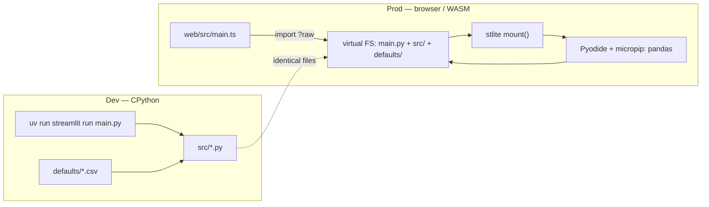
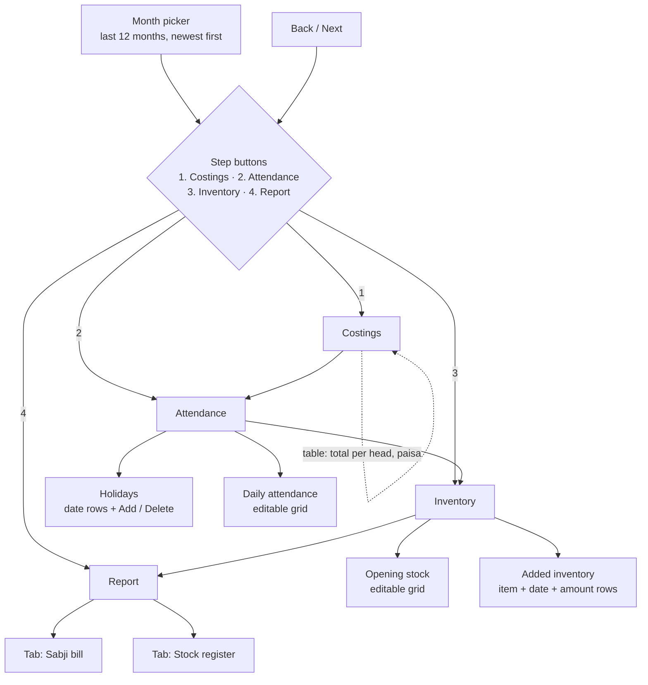

# ICDS Reports

A four-step worksheet app for an ICDS (anganwadi) centre. It turns a month of head
counts, per-head rates and stock figures into the two sheets the office submits:
the **sabji bill** and the **stock register**. It runs as a static site in the
browser — no Python server in production — and the same Python source runs natively
during development.

- **Dev**: regular Streamlit on CPython (`uv run streamlit run main.py`) — full
  tooling, debugger, hot reload, pytest.
- **Prod**: the *same* Python files are bundled into an
  [stlite](https://stlite.net) (Pyodide/WASM) static site via Vite.
- **JS toolchain**: **Bun only** (`bun run`, `bunx` — no npm/yarn/pnpm).

---

## 1. What the app produces

Both reports are one row per day of the chosen month, followed by a closing `Total`
row. Every figure is derived from four inputs; nothing is typed into the reports
directly.

| Report | What it answers | Tab |
|---|---|---|
| **Sabji bill** | What did the day's food cost, and how many heads were served? | `Report` → *Sabji bill* |
| **Stock register** | What came in, what was issued, what is left of each commodity — plus the same money figures | `Report` → *Stock register* |

The full column-by-column derivation lives in [`calculation.md`](calculation.md).
The code that implements it is `src/calculation.py`.

---

## 2. Inputs

There are four inputs the reports are computed from, plus the keys that select
*which* month and *which* days are working days.

| # | Input | Unit | Held in | Edited on | Feeds |
|---|---|---|---|---|---|
| 1 | **Month** | a month | `st.session_state["month"]` | month picker, above the steps | every step |
| 2 | **Costings** (per-head cost) | **paisa** per head per serving day | `defaults/per_head_costs_paisa.csv` | Step 1 — Costings | every money column of both reports |
| 3 | **Per-head inventory** | grams / millilitres per head per serving day | `defaults/per_head_inventory.csv` | Step 1 — Costings | consumption columns of the register |
| 4 | **Attendance** (mothers, children) | head counts per day | built from the calendar; lives in `st.session_state["attendance"]` | Step 2 — Attendance | all attendance columns, all money, all consumption |
| 5 | **Holidays** | a set of dates | `st.session_state["holidays"]`, per-month rows | Step 2 — Holidays | which days have no attendance |
| 6 | **Opening stock** | item's own unit (`g`, `ml`) | `defaults/initial_inventory.csv` | Step 3 — Opening stock | where each commodity's ledger starts |
| 7 | **Added inventory** | item's own unit | `st.session_state["added-inventory"]` | Step 3 — Added inventory | deliveries into the register's ledger |

Notes on how inputs behave:

- **Rate of `0` means "not served".** The column is written *blank*, never `0`. This
  is what makes a blank cell in the report meaningful rather than ambiguous.
- **A closed day is blank.** Attendance there is `NaN`, and every derived column on
  that row is blank; the stock ledger does not move.
- The shipped defaults are starting values, not constants — every one of them is
  editable in the UI, and edits live in session state (and in IndexedDB in the
  browser build, see §4.4).

### 2.1 Costings — `defaults/per_head_costs_paisa.csv`

Paisa per head per day. Rate `0` = not served to that head on that day type.

| item | Mother MWF | Mother TTS | Children MWF | Children TTS | Purpose |
|---|---|---|---|---|---|
| `egg` | 850 | 850 | 850 | 0 | Total egg cost; register *Item 2* |
| `vegetables` | 0 | 23 | 0 | 41 | Sabji bill veg columns; register *Vegetable Value* |
| `potato` | 84 | 140 | 0 | 168 | Sabji bill potato columns; register *Potato Value* |
| `morning_snack` | 0 | 0 | 167 | 425 | One snack item, one rate per day type: the **Mon/Wed/Fri** rate is register *Item 1*, the **Tue/Thu/Sat** rate is added into register *Item 2* |

The file carries a derived `total` row (934 / 1013 / 1017 / 634) which the app drops
on read; it is only there so the sheet reads like the paper one.

### 2.2 Per-head inventory — `defaults/per_head_inventory.csv`

Quantity per head per serving day, in the unit named in the item
(`_g` = grams, `_ml` = millilitres). Drives the register's consumption columns.

| item | Mother MWF | Mother TTS | Children MWF | Children TTS |
|---|---|---|---|---|
| `rice_g` | 110 | 75 | 50 | 75 |
| `masoor_dal_g` | 0 | 30 | 0 | 30 |
| `mustard_oil_ml` | 2 | 2 | 2 | 2 |
| `iodised_salt_g` | 2 | 2 | 2 | 2 |

A `0` here means the commodity is not served to that head on that day type, so no
balance and no consumption is written and the stock is carried untouched.

### 2.3 Opening stock — `defaults/initial_inventory.csv`

The stock each commodity's ledger starts from, before day 1.

| commodity | opening |
|---|---|
| `rice_g` | 25640 |
| `masoor_dal_g` | 20400 |
| `mustard_oil_ml` | 3272 |
| `iodised_salt_g` | 3272 |

### 2.4 Attendance — derived from the calendar, then edited

There is no attendance file in the app. The sheet is built for the chosen month and
then edited in Step 2:

- one row per calendar day, indexed by date and always ascending;
- **every Sunday is a holiday** to start with, so it holds `NaN`;
- a working day starts at **4 mothers / 28 children** (`DEFAULT_MOTHERS`,
  `DEFAULT_CHILDREN` in `src/data.py`);
- head counts are whole numbers, minimum 0.

`attendance_sheet()` builds it; the editor's edits are kept in
`st.session_state["attendance"]` and are laid onto a new month **by day of month**,
so September's 5th reuses October's 5th counts.

### 2.5 Holidays

Holidays are the *only* thing that closes a day — removing a row turns that day back
into a working day. Rows are date pickers, kept in date order, with a weekday badge
and a delete button; duplicate dates collapse to the first row.

### 2.6 Added inventory — deliveries during the month

Entered in Step 3, one row per delivery: item, date (clamped to the month), amount.
A delivery **counts from its own day on**, so it is in stock for that day's issue and
every day after it. The register's ledger adds it at the start of that day.

---

## 3. Architecture

### 3.1 Two runtimes, one source tree

`main.py` is the single entrypoint in both. On CPython, `src/data.py` reads
`defaults/*.csv` from disk. In the browser, `web/src/main.ts` inlines those same CSVs
with Vite's `?raw` import and hands them to stlite as a virtual filesystem, so
`src/data.py` reads them from the same relative paths — no code branches for WASM.

### 3.2 Files

| Path | Responsibility |
|---|---|
| `main.py` | Page config + title; calls `ui.stepper()`. Runs unchanged on both runtimes. |
| `src/data.py` | The four inputs as data: read `defaults/` CSVs, item labels ↔ keys, recent months, month bounds, Sundays, the per-day attendance frame. |
| `src/calculation.py` | The two reports, column by column: day types, per-head arithmetic, the stock ledger, money conversion, the closing `Total` row. |
| `src/ui.py` | The month picker, the four-step navigation, and the editors for each step. |
| `defaults/*.csv` | The shipped starting values for costings, per-head inventory and opening stock. |
| `calculation.md` | The written specification the calculation implements. |
| `web/index.html` | Static host page; loads stlite's stylesheet from the pinned CDN. |
| `web/src/main.ts` | Pins the stlite version, inlines the Python + CSV sources, mounts the app, wires `?reset=1`. |
| `web/src/boot.py` | WASM-only entrypoint: installs the persistence shim, then runs `main.py`. |
| `web/src/persist.py` | WASM-only monkey-patch of `st.data_editor` that saves/restores edited frames under `/data`. |
| `web/vite.config.ts` | `root=web`, `base=./`, output `dist/`. |
| `tests/test_calculation.py` | Compares both reports against a real month in `tests/data/`. |
| `tests/test_attendance.py` | Asserts the attendance frame is date-indexed, sorted and complete. |

### 3.3 Calculation conventions (`src/calculation.py`)

Three rules run through the whole module:

1. **Blank means "nothing to write"** — a closed day, or an item not served that day.
   Whether an item is served comes from its rate being above 0.
2. **Money is computed in paisa**, the unit of the cost table, and divided by 100 when
   the report is assembled. The reports carry rupees.
3. **Quantities stay in the item's unit** — grams for `rice_g`, millilitres for
   `mustard_oil_ml`. The sheet titles those columns Kg and Ltr, as the paper does.

Day types come from the calendar: `MWF` on Monday/Wednesday/Friday, `TTS` on every
other day. The ledger walks the month in date order: `issued = min(ration, stock)`,
never more than is on hand, and the balance settles at `0` when the ration exceeds it.
The `Total` row sums everything except balance columns, which report the **closing
balance at month end**, not a sum.

### 3.4 State model (`st.session_state`)

| Key | Holds |
|---|---|
| `month` | the first day of the selected month |
| `step` | index `0..3` of the open step |
| `costs` | the edited per-head cost frame |
| `inventory` | the edited per-head quantity frame |
| `opening` | the edited opening-stock frame |
| `attendance` | the edited attendance frame (date-indexed) |
| `holidays` | the selected month's closed dates |
| `holiday-rows-<YYYY-MM>`, `-seeded`, `-next` | the holiday rows themselves, per month |
| `attendance-redraw-<YYYY-MM>` | counter appended to the attendance editor key to force a blank redraw |
| `added-inventory` | the list of delivery rows |

### 3.5 Persistence (browser build only)

A refresh starts a new Streamlit session, so `session_state` would be lost. stlite
mounts `/data` onto an IndexedDB-backed filesystem (`idbfsMountpoints` in
`web/src/main.ts`), and `web/src/persist.py` patches `st.data_editor` so that:

- each editor's frame is pickled to `/data/editors.pkl` after the call and restored
  before the next one;
- a cell the app built blank (a Sunday, a holiday) is never saved and never restored,
  so the attendance wipe-and-redraw rule still wins and cannot loop;
- the redraw counter is stripped from the key, so a redraw does not throw away the
  month.

`?reset=1` deletes the database and starts from the bundled defaults. Under plain
CPython `/data` does not exist, every write is skipped, and the patch is not installed.

---

## 4. Navigation

The month sits above everything and applies to all four steps. Step buttons show a
check icon once passed; `Back` is disabled on the first step and `Next` on the last.
Both just set `st.session_state["step"]` and rerun — there is no separate page or
router.

### Step 1 — Costings

Two editable grids, one screen:

- **Costings**: item is fixed (read-only), every rate a whole number ≥ 0, caption
  "Cost per head per day, in paisa. A rate of 0 means not served."
- Below it, a read-only **total per head** row (paisa).
- **Per-head inventory**: same shape, in the item's unit.

Edits are written back to session state on every run, so later steps see them.

### Step 2 — Attendance

- **Holidays** — one row per closed date: a date picker, a weekday badge, a `Delete`
  button, plus `Add holiday`. Deleting a row makes that day a working day. A blank new
  row sorts last; same-date rows collapse to one.
- **Daily attendance** — a date-indexed grid with `Date`, `Mother`, `Children`.
  Holidays show `NaN` and are labelled `placeholder="NaN"`. Header sorting is
  deliberately blocked with a CSS shield over the header band, because the rows are a
  calendar and have a fixed order. A value typed on a closed day is dropped and the
  sheet is redrawn blank (Streamlit can only lock whole columns, not cells).

### Step 3 — Inventory

- **Opening stock** — item read-only, `Opening` a whole number ≥ 0.
- **Added inventory** — a row per delivery (`Item`, `Date added`, `Amount`) with
  `Delete` per row and `Add item`. Rows live in session state, not in the widgets, so
  deleting one shifts the rest onto their new values cleanly.

### Step 4 — Report

Titled `Report — <Month Year>`, with two tabs:

- **Sabji bill** — attendance columns, then egg, veg, potato, the combined
  veg+potato, the two morning snacks, and `Daily Total Cost`.
- **Stock register** — attendance columns, the eight ledger columns of the four
  commodities, the two blank `Commodity 5` columns, and the four money columns.

Both are read-only, 520 px tall, money shown to two decimals, `Date` written as text so
it can share a column with the `Total` label. Caption: "A blank cell is a closed day,
or an item that is not served that day."

---

## 5. Rules worth knowing

| Situation | Behaviour |
|---|---|
| Sunday or holiday | every column except `Date` is blank; the stock ledger does not move |
| Rate is 0 for that head/day type | that column is blank, not 0 |
| Ration exceeds stock | issue only what is left, balance becomes 0 |
| Commodity not served today | blank balance and blank consumption; stock carried |
| Delivery mid-month | in stock from its own day on |
| Something changed above | the report recomputes on the next run — there is no "generate" button |
| Switching month | attendance carries over by day of month; holidays are per month |

---

## 6. Running it

| Command | What it does |
|---|---|
| `bun run dev` | Streamlit on CPython (full tooling). |
| `bun run dev:web` | Vite dev server for the browser/WASM path. |
| `bun run build` | Static build into `dist/` (`base: "./"`, works from any subpath). |
| `bun run preview` | Serve the built `dist/` (default `http://localhost:4173`). |
| `bun run test:e2e` | Playwright smoke test against the preview server. |

Quality gates (per `AGENTS.md`): `uvx pyrefly check` and `uv run pytest`. Run them at
the end of a piece of work, not after every edit. §7 covers both gates and the
browser smoke test.

### Pinned versions

| Package | Version | Where | Note |
|---|---|---|---|
| `@stlite/browser` | 1.12.0 | CDN (jsDelivr) | Stay on ≥ 1.12.0: 1.11.0's bundled Streamlit fails in `st.data_editor` with `NameError: arrow_table` whenever a `key` is passed. |
| Streamlit | ≥ 1.66.0 | PyPI (dev) | Dev-only; the browser build uses stlite's own bundled Streamlit. |
| pandas | ≥ 3.0.6 | PyPI | Pure-Python wheel, fetched by micropip in the browser. |
| Python | ≥ 3.14 | dev | stlite's runtime is Pyodide's own CPython. |

### Pyodide guardrails (production)

No threads, no `subprocess`, no raw sockets; pure-Python wheels only.
`time.sleep()` is a no-op — use `asyncio.sleep()`. `requests`/`urllib` work through
pyodide-http patches.

---

## 7. Testing

Two suites cover the app. A Python suite runs with pytest on `tests/`. One browser
smoke test runs with Playwright against a built `dist/`. The Python suite holds 13
cases in two files.

| File | Cases | What the file proves |
|---|---|---|
| `tests/test_calculation.py` | 3 | Both reports match a real month, and a delivery moves only its own ledger. |
| `tests/test_attendance.py` | 10 | The attendance frame keeps one row per day, in date order, through every route that rebuilds it. |

### 7.1 Python suite — `uv run pytest`

`pyproject.toml` sets `testpaths = ["tests"]` and `pythonpath = ["."]`. The suite
therefore runs from the repository root and imports `src` directly.

#### `tests/test_calculation.py` — the reports against a real month

Every input and both expected reports live in `tests/data`. A new month is a folder
of files, not a new test. [`tests/data/README.md`](tests/data/README.md) lists the
files and the three figures where the office sheets disagree with `calculation.md`.

Four helpers keep the tests short:

| Helper | Job |
|---|---|
| `_per_head(name)` | Reads a per-head sheet with its two header rows, then drops the derived `total` row. |
| `_register(additions=None)` | Builds the month's register from the input sheets, with optional deliveries. |
| `_with_total(report)` | Appends the closing `Total` row that the paper sheets carry. |
| `_matches(produced, name)` | Compares column names, then every number, against the sheet. |

`_matches` compares numbers, not text. It reads the sheet, converts `Date` to a
number, and casts both frames to `float64`. `pd.testing.assert_frame_equal` then
fails on any changed figure or column order.

| Test | What it does |
|---|---|
| `test_sabji_bill_matches_the_sheet` | Builds the bill from `attendance.csv` and `per_head_costs_paisa.csv`, adds the `Total` row, and compares it with `sabji_bill.csv`. |
| `test_stock_register_matches_the_sheet` | Builds the register from all four input sheets, adds the `Total` row, and compares it with `stock_register.csv`. |
| `test_stock_register_delivers_mid_month_stock_on_its_own_day` | Adds a 30 kg rice delivery on 17 August 2026 and checks six rules on the result. |

The delivery test walks the rules of §2.6 in order:

1. Days before the delivery do not change. The stock is not there early.
2. The whole amount is in stock on the delivery day.
3. That day's issue draws the full ration.
4. Every later written day carries the amount still on hand. The gap to the
   undelivered register closes by the extra issued so far.
5. No other commodity, count or money column changes.
6. The `Total` row closes at `opening + delivered - issued`.

#### `tests/test_attendance.py` — the frame order

These tests run the real app through `streamlit.testing.v1.AppTest`. Each test opens
`main.py`, sets `step = 1` and a month, then runs. The app must raise no exception.

`_assert_sorted` holds the one rule that every test reuses. The frame index must be a
`DatetimeIndex` named `date`, monotonic increasing, unique, and equal to every day of
the month.

| Test | What it does |
|---|---|
| `test_the_sheet_starts_sorted` | The freshly built month is one row per day, in date order. |
| `test_the_sheet_stays_sorted_after_an_edit` | An edit arrives in the editor's own row order. The app re-sorts the frame and keeps the new counts. |
| `test_the_sheet_stays_sorted_after_adding_a_holiday` | A holiday on a Thursday blanks its row and leaves the order alone. |
| `test_deleting_a_holiday_removes_that_row_alone` | Each delete button belongs to its own row. Deleting the first Sunday reopens that day and leaves the other holidays closed. The picker keys must shift by exactly one, because a carried-over value would delete the last row instead. |
| `test_the_sheet_stays_sorted_when_the_saved_frame_repeats_a_day` | A saved frame with a repeated day still restores as one unique row per day. |
| `test_the_sheet_stays_sorted_after_changing_month` | A new month rebuilds the days, and the counts carry over by day of month. |
| `test_every_month_is_sorted` | The three newest months the picker offers all come out in their own date order. |
| `test_the_sheet_cannot_be_sorted_by_a_column` | The rendered HTML still carries the CSS shield over the header band. |

### 7.2 Browser smoke test — `bun run test:e2e`

`e2e/spike.spec.ts` runs with `@playwright/test`. `e2e/playwright.config.ts` points
the run at `http://localhost:4173/`, which `bun run preview` serves. Set
`E2E_BASE_URL` to test another host. The run uses headless Chromium at 1280x720, with
a 120 second timeout for each step.

The test boots the WASM site and checks four things:

1. The app title is visible within 90 seconds. The first Pyodide boot installs pandas
   through `micropip`.
2. An AG Grid root is visible in the page or in a child frame.
3. At least one data row renders.
4. Scrolling the grid body moves `scrollTop` above 0.

The test collects console errors and page errors, prints them, and does not fail on
them. Treat the printed list as a warning, not as a pass.

This test is a Phase 0 spike. It waits for the title
`Spike: streamlit-aggrid on stlite`, which the current app does not render, so it
covers the grid spike page and not the four-step worksheet. `e2e/diag.mjs` is a manual
companion. It prints console output, failed requests and wheel downloads for one page
load, then exits.

### 7.3 Quality gates

| Gate | Command | What it checks |
|---|---|---|
| Types | `uvx pyrefly check` | `src` and `tests`, per `[tool.pyrefly]` in `pyproject.toml`. |
| Python suite | `uv run pytest` | The 13 cases above. |
| Browser smoke | `bun run test:e2e` | Needs `bun run build` and `bun run preview` first. |

`AGENTS.md` asks for the first two gates at the end of a piece of work, not after every
edit. Do not add, change or delete a test unless the request asks for it.

---

## 8. Glossary

| Term | Meaning |
|---|---|
| **MWF / TTS** | the two day types: Monday-Wednesday-Friday / Tuesday-Thursday-Saturday |
| **Head** | a beneficiary group: `mother` (pregnant + lactating) or `children` |
| **Served** | the item's rate for that head and day type is above 0 |
| **Sabji bill** | the daily food-cost sheet |
| **Stock register** | the commodity ledger plus the money figures |
| **Opening stock** | stock on hand before day 1 |
| **Added inventory** | stock delivered during the month |
| **Consumption** | what was actually issued that day |
| **Balance** | stock on hand at the start of the day, before that day's issue |
| **Blank** | "nothing to write": a closed day, or an item not served |
